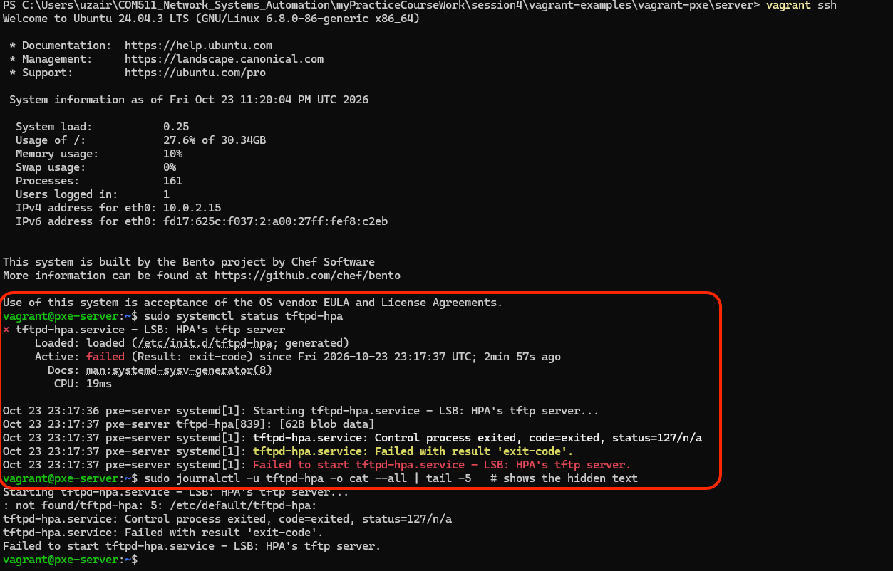
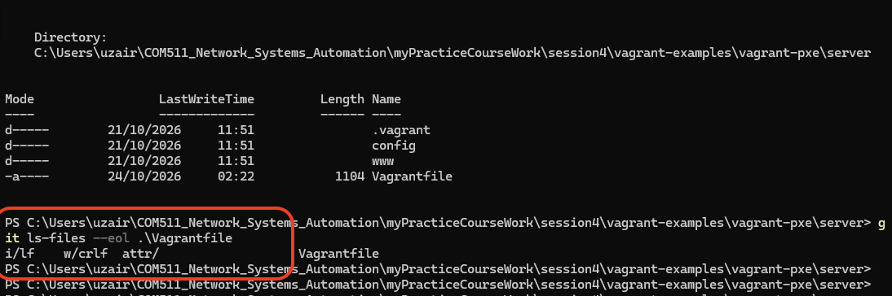
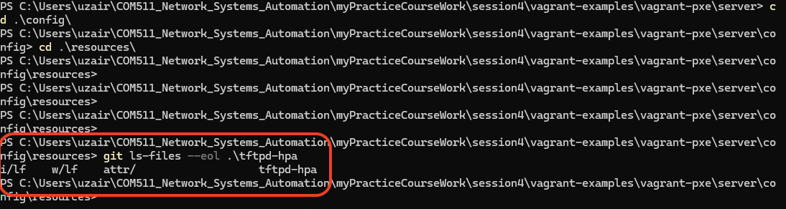
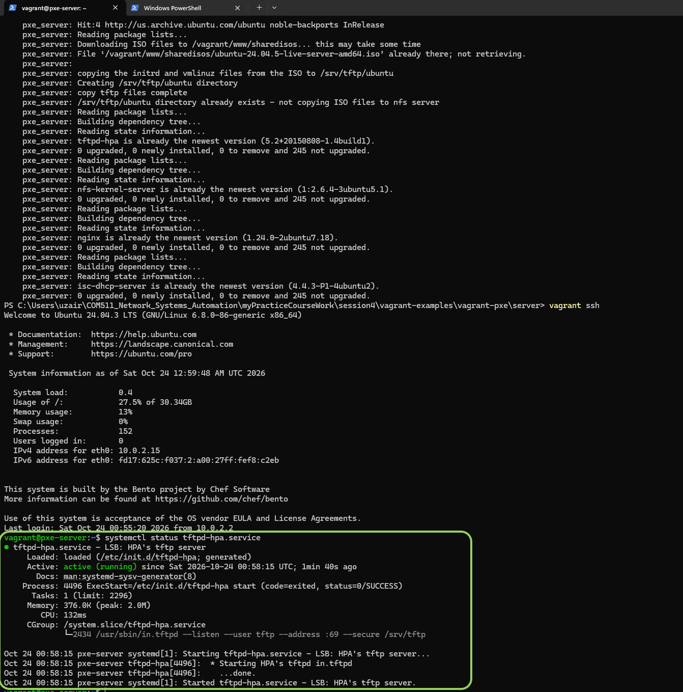
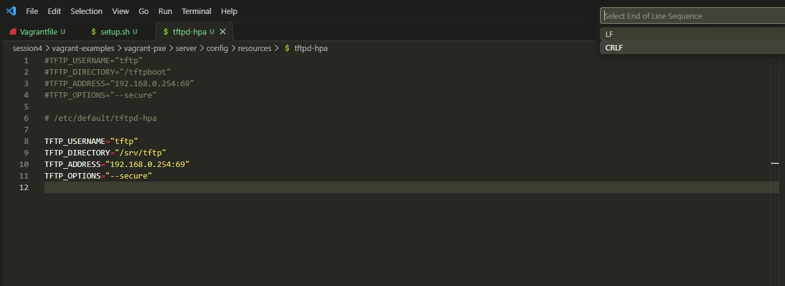
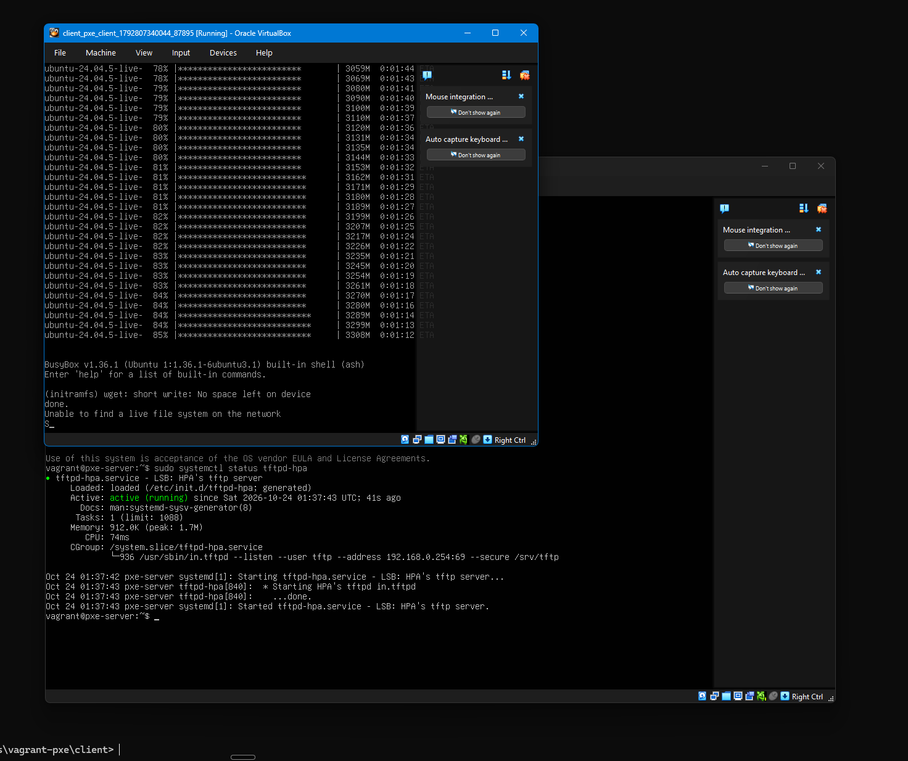

[Personal Learning Record](../../personal_journal/personal_journal.md) | [Session Notes](../sessions/README.md) 

# Session 4

## Topics covered
*What topics were covered in this session*
* Automated bare metal deployment with PXE boot
* PXE boot process: client gets IP and boot file from DHCP, downloads bootloader over TFTP, loads the OS
* DHCP server
* TFTP server
* Booting from an NFS share
* nginx web server
* Unattended install with cloud-init (autoinstall / user-data)
* Building the PXE server automatically with Vagrant and a provisioning script (`setup.sh`)

## Personal Notes and research following this session
*Which class sessions and personal research refers to technology in this proposal. Link to examples.*
* Stack Overflow thread on Git CRLF/LF conversion: [CRLF/LF on Stack Overflow](https://stackoverflow.com/questions/1967370/git-replacing-lf-with-crlf)
* Git documentation: [gitattributes](https://git-scm.com/docs/gitattributes)
* GitHub guide on line endings across Windows, macOS and Linux: [Configuring Git to handle line endings](https://docs.github.com/en/get-started/getting-started-with-git/configuring-git-to-handle-line-endings)
* Git setting that converts LF to CRLF on Windows checkouts: [core.autocrlf](https://git-scm.com/docs/git-config#Documentation/git-config.txt-coreautocrlf)
* Commands used to check the fix: [git check-attr](https://git-scm.com/docs/git-check-attr) and [git ls-files --eol](https://git-scm.com/docs/git-ls-files#Documentation/git-ls-files.txt---eol)

## Exercises and results
*What exercises did you complete. What results. Screen shots and notes*

The goal was to get the PXE server running and the client VM to boot from it and install Ubuntu automatically. I ran into two issues that prevented this from happening.

### Issue 1: Line endings
* From what I could find, provisioning the PXE server failed because a file had the wrong line ending


* Windows uses CRLF to end lines, Linux uses LF
* Git on Windows was converting LF to CRLF on checkout. Fine for files used on Windows, but these two run inside the Linux VM:
  * `tftpd-hpa`: configuration for the TFTP server
* Linux could not read them correctly with CRLF endings, so setup failed

#### Solution
* Changed both files to LF
* Researched on Stack Overflow: same [problem reported](https://stackoverflow.com/questions/1967370/git-replacing-lf-with-crlf) about 13 years ago




We can check the line endings of a file with `git ls-files --eol <file>`. The outputs in the screenshot show that the `Vagrantfile` is `CRLF` and `tftpd-hpa` file is now set to `LF` which is what the Linux VM needs.

* **More Permanent Fix**: We can set Git attributes (`.gitattributes`) so Git does not convert line endings for these files in future checkouts:
  * Added a `.gitattributes` file at the root of the repo
  * Only files that run inside the Linux VMs/containers are forced to LF (`*.sh`, `*.conf`, `tftpd-hpa`)
  * I did not use a catch-all rule (`* text eol=lf`), because it would also hit any Windows scripts (`.bat`/`.ps1`) added later, and those need CRLF

Added these lines to the `.gitattributes` file at the root of the repo:
  ```bash
  *.sh             text eol=lf
  *.conf           text eol=lf
  tftpd-hpa        text eol=lf
  isc-dhcp-server  text eol=lf
  user-data        text eol=lf
  **/pxelinux.cfg/default text eol=lf
  *.png            binary
  *.c32            binary
  ```


**Result**: provisioning now runs smoothly



To fix line endings, we can use `git add --renormalize .` to re-add all files in the repo, and then commit the changes. This will fix any line endings that are not consistent with the `.gitattributes` file.

Other ways to fix line endings include using `dos2unix` or `unix2dos` commands, or using a text editor that can convert line endings (like VS Code).


<!--  -->

### Issue 2: Not enough RAM
* Laptop ran out of RAM when I tried to run both the PXE server and the client VM at the same time
* Client VM stopped while downloading the ISO files, so the install failed
* Lowered the server VM's RAM and added 1 GB to the client VM, same result



My conclusion: fixing the line endings was a prerequisite to getting the PXE server working, but the RAM issue was a separate problem that needed to be solved before the client could successfully boot and install, which I can't as my laptop lacks sufficient RAM.

The two issues were different kinds of problem:
* **Line endings** was a configuration problem. It was caused by how Git handled the files on Windows, so I could fix it myself and stop it happening again with `.gitattributes`
* **RAM** was a hardware limit. Changing how memory was split between the VMs did not help, because both VMs together need more RAM than my laptop has

Next steps to finish the exercise:
* Run the lab on a machine with more RAM (e.g. a university lab PC) and repeat the client boot
* Check how much memory the Vagrantfiles give each VM before running `vagrant up`, so I know if the host can run both
* Check if we can use an ftp server instead of a PXE server to install the client VM, which may use less RAM

## Summary of learning
*What did you learn through these exercises*
* Windows and Linux use different line endings; scripts and config files run on Linux need LF
* Git can change line endings automatically, and `.gitattributes` controls this per file
* Files edited on the host are copied into the VM, so host-side mistakes can break the VM
* VMs share the host's RAM; it has to be split sensibly between server and client
* PXE boot depends on several services working together (DHCP, TFTP, nginx, cloud-init), so one broken config file can stop the whole chain
* `git ls-files --eol <file>` shows a file's line endings in the repo and in the working copy, which is a quick way to confirm a CRLF problem
* Line endings can be fixed in several ways: `git add --renormalize .` after adding `.gitattributes`, `dos2unix`, or changing CRLF to LF in VS Code
* A catch-all `.gitattributes` rule can create new problems (Windows scripts need CRLF), so it is safer to list only the files that run on Linux
* Reading the error message from `vagrant up` and searching for it (Stack Overflow, Git docs) led straight to the cause. It turned out to be a common problem
* Some problems are configuration I can fix; others, like not having enough RAM, are hardware limits I have to work around