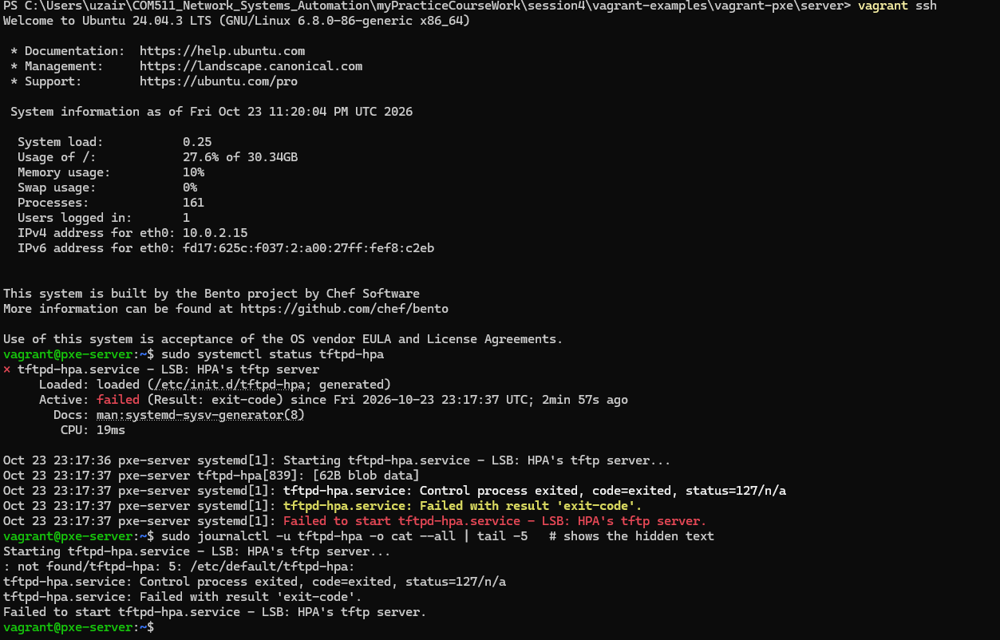
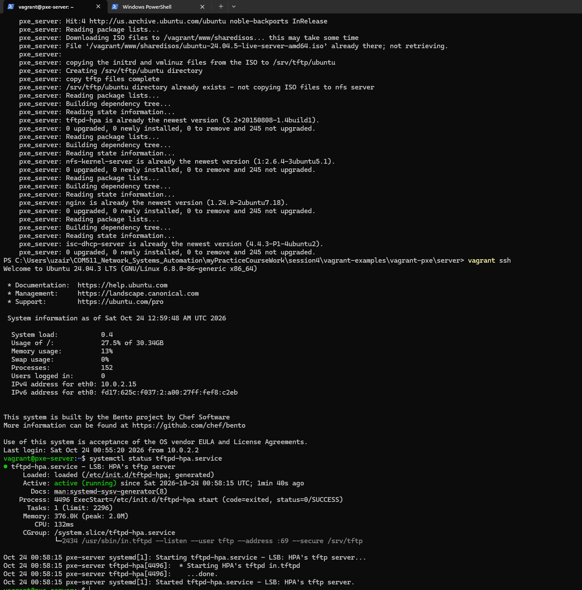
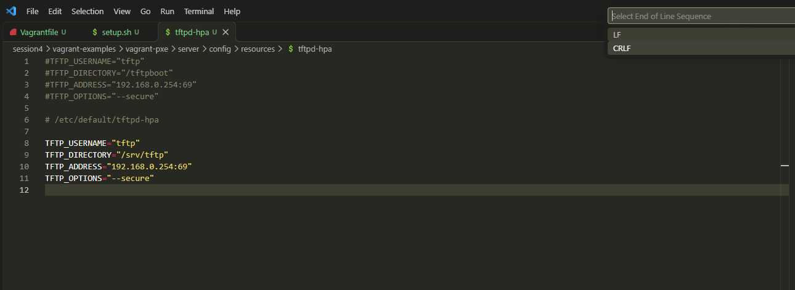
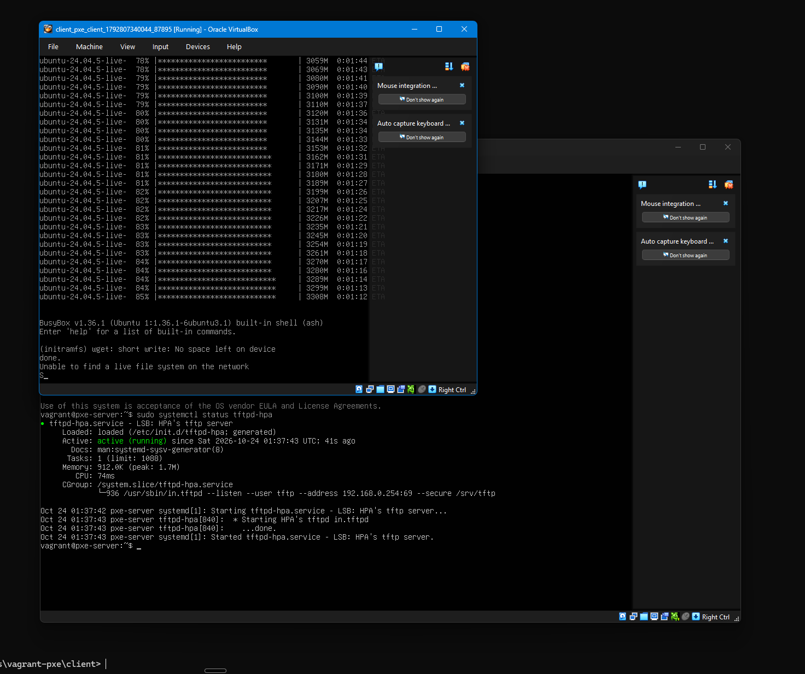

[Personal Learning Record](../../personal_journal/personal_journal.md) | [Session Notes](../sessions/README.md) 

# Session 4

## Topics covered
*What topics were covered in this session*
* Automated bare metal deployment with PXE boot
* PXE boot process: client gets IP and boot file from DHCP, downloads bootloader over TFTP, loads the OS
* DHCP server
* TFTP server
* Booting from an NFS share
* nginx web server
* Unattended install with cloud-init (autoinstall / user-data)
* Building the PXE server automatically with Vagrant and a provisioning script (`setup.sh`)

## Personal Notes and research following this session
*Which class sessions and personal research refers to technology in this proposal. Link to examples.*
* Stack Overflow thread on Git CRLF/LF conversion: [CRLF/LF on Stack Overflow](https://stackoverflow.com/questions/1967370/git-replacing-lf-with-crlf)
* Git documentation: [gitattributes](https://git-scm.com/docs/gitattributes)

## Exercises and results
*What exercises did you complete. What results. Screen shots and notes*
### Issue 1: Line endings
* Provisioning the PXE server failed because two files had the wrong line endings

* Windows uses CRLF to end lines, Linux uses LF
* Git on Windows was converting LF to CRLF on checkout. Fine for files used on Windows, but these two run inside the Linux VM:
  * `setup.sh`: provisioning script, updates the VM and installs the initial software (TFTP, NFS, nginx, DHCP)
  * `tftpd-hpa`: configuration for the TFTP server
* Linux could not read them correctly with CRLF endings, so setup failed
* Changed both files to LF
* Researched on Stack Overflow: same problem reported about 13 years ago
* Fix found: set Git attributes (`.gitattributes`) so Git does not convert line endings for these files
* Result: provisioning now runs smoothly

<!--  -->

### Issue 2: Not enough RAM
* Laptop ran out of RAM with both VMs running
* Client VM stopped while downloading the ISO files, so the install failed
* Lowered the server VM's RAM and added 1 GB to the client VM
* Result: retest in progress

My conclusion: fixing the line endings was a prerequisite to getting the PXE server working, but the RAM issue was a separate problem that needed to be solved before the client could successfully boot and install, but I can't as my laptop lacks sufficient RAM.

## Summary of learning
*What did you learn through these exercises*
* Windows and Linux use different line endings; scripts and config files run on Linux need LF
* Git can change line endings automatically, and `.gitattributes` controls this per file
* Files edited on the host are copied into the VM, so host-side mistakes can break the VM
* VMs share the host's RAM; it has to be split sensibly between server and client